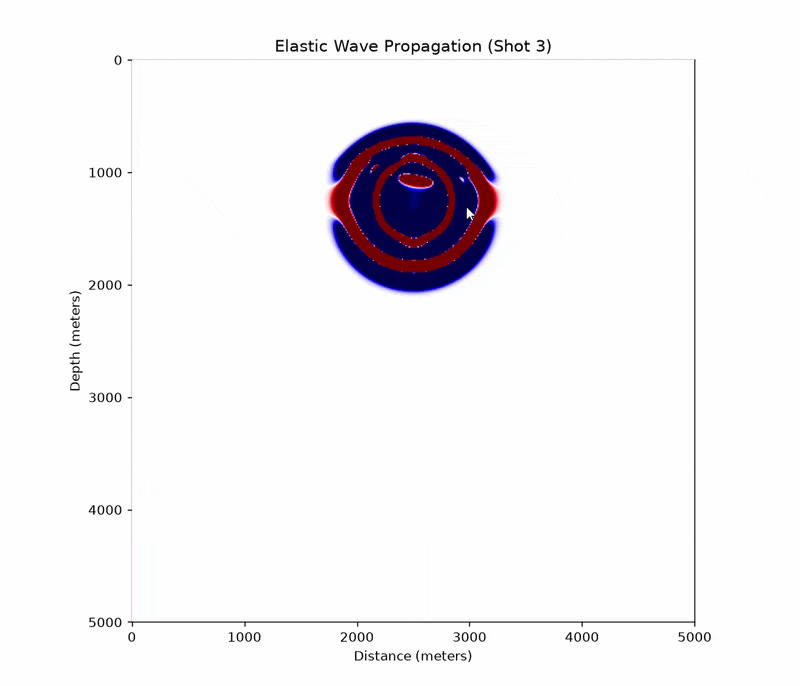
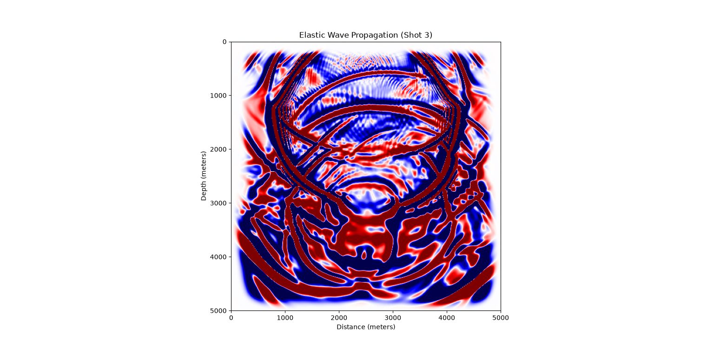
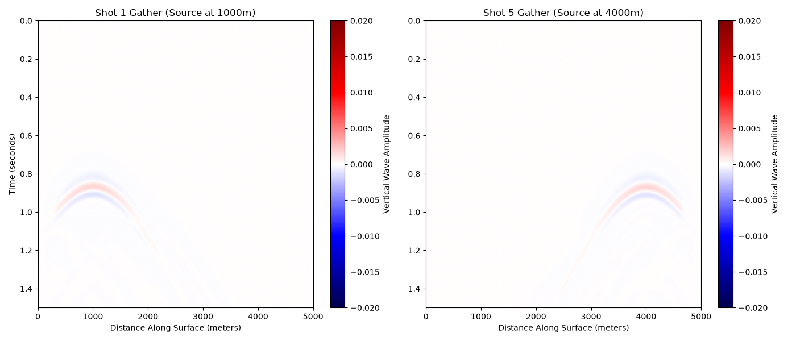
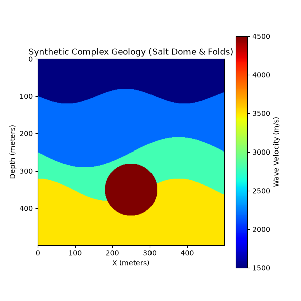

# 2D Elastodynamic Seismic Wave Engine

## Overview
This repository contains a high-performance 2D elastodynamic Finite-Difference Time-Domain (FDTD) solver developed and submitted for IIT Bombay's ResCon 2026. It simulates coupled P and S wave propagation through complex geological media. 

The computational core is written in C and optimized using OpenMP for heavy tensor mathematics and multi-threaded parallel processing. It implements Cerjan-type sponge-layer absorbing boundary conditions to prevent artificial reflections, while a Python frontend handles velocity model injection and output visualization.

## Simulation Results





## Project Workflow & Execution
The simulation relies on three main scripts to generate the environment, run the math, and render the output. 

**Prerequisites:** GCC compiler with OpenMP support, and Python 3.x (with `numpy` and `matplotlib`).
```
**1. Generate the geological model**
`build_geology.py` creates the 2D geological velocity/density models and exports them as binary input for the solver.
Bash
python build_geology.py
2. Compile the FDTD solvermain.c is the core numerical engine that applies the mathematical operators and calculates the stress/strain fields.

Bash
gcc -fopenmp main.c -o solver -lm
3. Execute the simulation

Bash
./solver
4. Visualize the wavefieldanimate.py reads the binary outputs from the C solver and renders animated heatmaps of the wave propagation.

Bash
python animate.py
```
Author
Abhijit Gupta
BS-MS Dual Degree Student
Indian Institute of Science Education and Research (IISER), Bhopal
1. Compile the C engine: gcc wave2d.c -o wave2d -lm
2. Run the executable to generate the wave_animation.bin file.
3. Execute the visualization script: python animate.py
